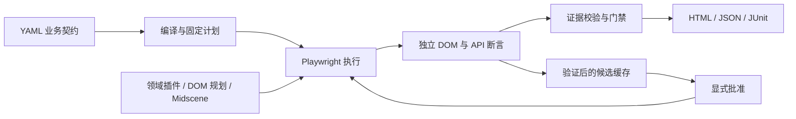
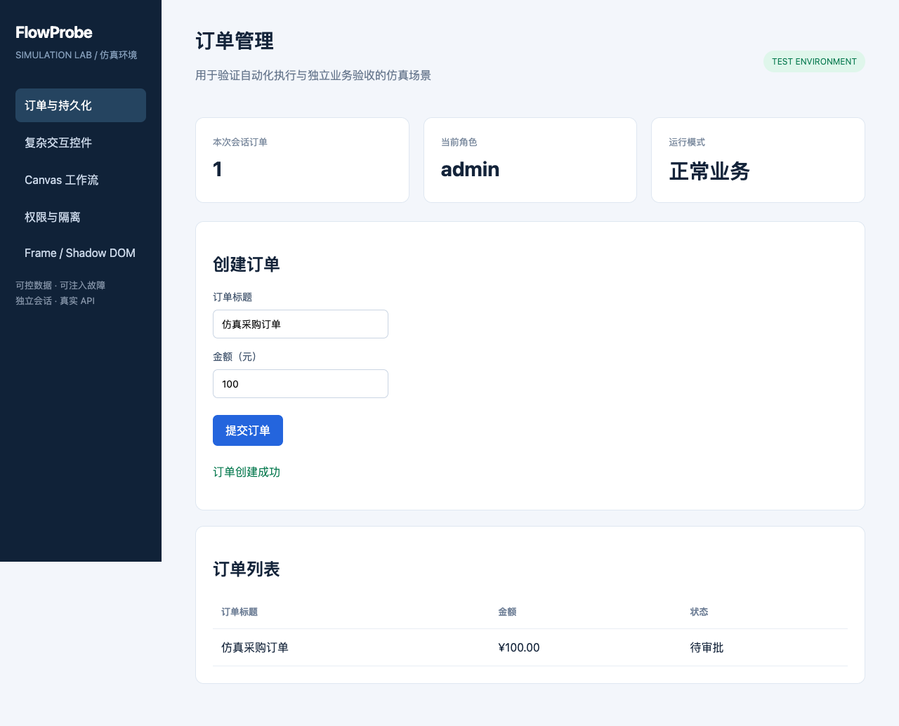

> 归档：此目录保留原有契约驱动测试平台，当前主入口已改为自然语言任务直接执行。下文为归档前的说明。若需运行旧功能，请在此目录单独安装依赖并执行命令；它不参与根目录的构建和测试。

# FlowProbe

基于 TypeScript 的契约驱动网页自动化测试平台。以明确的业务断言决定通过，以真实浏览器与 API 证据证明结果，逐步结合视觉执行、验证后缓存和自主探索。

**当前开发中，整体设计尚未全部实现。** 可运行的部分：YAML 编译、固定执行计划、Playwright Test 执行、DOM/API 独立断言、证据归档、严格门禁、HTML/JSON/JUnit 报告，以及五类中文仿真页面。已增加领域插件、fixture 清理与验证后重放；已接入计量模型网关和受限 DOM／局部截图规划，已增加原生 Midscene 定位／任务适配；其他 Agent、探索覆盖与团队服务仍待实现；未知能力会报错，不静默跳过。

## 启动仿真环境

要求 Node.js ≥22.12，推荐 Node.js 24 LTS。

```bash
npm ci
npx playwright install chromium
npm run simulator
```

浏览器访问 `http://127.0.0.1:4173`。仿真站点包含订单持久化、异步控件、Canvas、权限、iframe 和 Shadow DOM。会话数据独立；订单页支持 `?fault=wrong-amount`、`?fault=fake-success`、`?fault=server-error` 故障注入。

## 编译和执行测试

在另一终端执行：

```bash
npm run flowprobe -- validate --cases examples/cases
npm run flowprobe -- plan --cases examples/cases --base-url http://127.0.0.1:4173
npm run flowprobe -- run --plan .flowprobe/plan.json --workers 2
```

报告写入 `artifacts/<runId>/index.html`，旁边保留机器报告、门禁、JUnit 和各 attempt 的截图、Trace、断言及事件。修改用例后重新生成计划。使用已安装的 Chrome 时，在 `plan` 命令添加 `--channel chrome`；计划显式记录 channel，避免隐式更换环境。

## 质量验证

```bash
npm run check
npm run test:acceptance
```

使用本机 Chrome 进行验收：

```bash
FLOWPROBE_TEST_CHANNEL=chrome npm run test:acceptance
```

`check` 执行严格 TypeScript 类型检查、Node 单元测试与编译。浏览器验收同时覆盖正常业务、误通过反例和完整 Runner/报告链路。CI 使用 Playwright 对应的 Chromium；本地 Chrome 验证不能替代跨浏览器验证。

## 工程结构

- `packages/protocol`：严格 schema、IR 与结果类型。
- `packages/compiler`：YAML、引用/变量校验、内容 hash 与不可变计划。
- `packages/core`：门禁、错误、变量和内容摘要。
- `packages/runner-playwright`：Playwright Test 生命周期与 attempt 执行。
- `packages/assertions`：实时 DOM/API 事实读取与断言。
- `packages/storage`、`packages/reports`：证据与 HTML/JSON/JUnit。
- `packages/plugins`、`packages/cache`：打包校验、fixture、领域断言、意图模板与验证后重放。
- `packages/cli`：validate、plan、run、report、cache list/promote。
- `examples/simulator`、`examples/cases`：仿真站点与可执行 YAML。

## 执行流程



## 仿真页面实测截图

下图来自本地真实浏览器测试，展示模拟订单创建后的页面。截图中的订单均为测试数据；测试同时读取 API 验证持久化结果。



## 当前验证范围与限制

- 单元测试覆盖契约、预算、缓存兼容性、证据门禁与轮询异常分类；浏览器验收覆盖五类页面、业务故障、插件清理、模型网关和原生 Midscene。
- AI 链路使用受控模型响应验证集成与误通过防护，尚未验证真实模型服务的成功率和成本。
- 本地验收使用系统 Chrome；Firefox、WebKit 和固定版本 Chromium 尚未完成本地验证。
- 原生 Midscene 是可选依赖。当前全量依赖审计仍有 9 个 high 条目（包含父依赖传播），涉及其 Zod 3 和 Puppeteer 的 extract-zip 链；核心依赖审计为 0。尚未消除全部上游风险。
- 截图、Trace 和模型观测尚无自动脱敏能力，请使用隔离的测试账号与测试数据。
- 设计文档保留在本地 `docs/`，不随代码发布。
